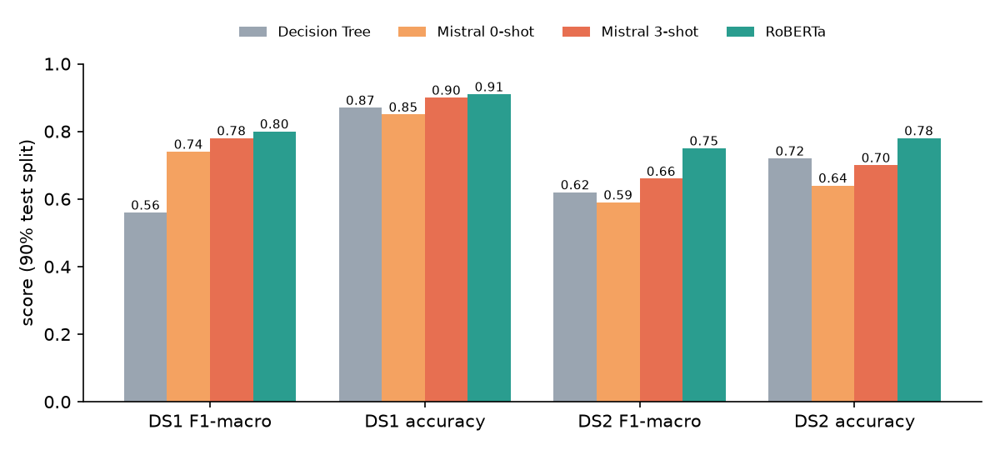

# Sentiment analysis with a pretrained, non-fine-tuned LLM

Can a general-purpose local LLM (Mistral 7B Instruct, prompted only, never fine-tuned) classify the sentiment of short texts as well as purpose-built models? Bachelor semester project at the [Idiap Research Institute](https://www.idiap.ch) (EPFL, spring 2024), published as Idiap research report [Idiap-RR-05-2024](https://publications.idiap.ch/attachments/reports/2024/Huou_Idiap-RR-05-2024.pdf).

## Results

Prompted Mistral 7B lands between a classical ML baseline and a RoBERTa model fine-tuned for emotion detection. 3-shot prompting with randomly drawn examples beats zero-shot on both datasets.



| Model (90% test split) | DS1 Messages F1-macro | DS1 accuracy | DS2 Tweets F1-macro | DS2 accuracy |
|---|---|---|---|---|
| Baseline: Decision Tree | 0.56 | 0.87 | 0.62 | 0.72 |
| Mistral 7B, zero-shot | 0.74 | 0.85 | 0.59 | 0.64 |
| Mistral 7B, 3-shot | 0.78 | 0.90 | 0.66 | 0.70 |
| Baseline: RoBERTa (fine-tuned for emotion) | 0.80 | 0.91 | 0.75 | 0.78 |

Source: Table 1 of the report. The report also shows that the Decision Tree degrades sharply when trained on one dataset and tested on the other, while the prompted LLM needs no training data at all.

### Re-scoring the saved outputs (added 2026)

`python score_results.py` re-scores the raw Mistral answers kept in `results/` in a few seconds, without running the LLM, and prints them next to Table 1. It needs both datasets (see below) because the ground-truth labels live there. Output:

```
run                 n test   paper F1/acc   repo F1/acc   prefix F1/acc
DS1 zero-shot         6732      0.74/0.85   0.61/0.68     0.77/0.88
DS1 3-shot            6732      0.78/0.90   0.54/0.58     0.74/0.84
DS2 zero-shot        27657      0.59/0.64   0.39/0.41     0.39/0.41
DS2 3-shot               -      0.66/0.70   saved outputs corrupted in the 2024 commit, cannot score
```

Plainly: the files in this repo do not reproduce Table 1.

- `repo` uses `data_evaluator.cleaner` as committed. Its phonetic fallback maps the answer "Neutral" to "Positive" on the two-class DS1, which pulls DS1 down.
- `prefix` reads only the first word of each answer. DS1 then lands near the paper, but the zero-shot and 3-shot numbers come out the other way round.
- DS2 zero-shot stays far below the paper with either parser: Mistral answered "Neutral" for half the tweets, while only 7% of them are neutral.
- `results/DS2_3_Shot_res.txt` was broken when it was committed in 2024 (its binary pickle bytes were re-encoded as UTF-8 text), so it cannot be loaded.

The likely explanation is that the evaluation pass behind the report is not fully captured in the committed code and outputs. Read Table 1 as the published result, and this script as an honest check of what the repo alone supports.

## How it works

1. `data_retriever.py` loads both emotion datasets and maps emotions to sentiment (joy to Positive; disgust, sadness, fear, anger, shame, guilt to Negative; neutral to Neutral; surprise dropped).
2. `data_player.py` prints dataset statistics after NLTK stopword removal.
3. `data_modeliser.py` runs Mistral 7B Instruct (GGUF, via `llama-cpp-python`, full GPU offload) over every text with a prompt from `prompts/`, optionally adding 3 random labelled examples (`--random_few_shot`). Predictions are pickled into `results/`.
4. `data_evaluator.py` cleans the free-form LLM output (NLTK normalisation, edit distance, fuzzy match, fallback label `majMap`) and produces confusion matrices and classification reports on the same 90% split as the baselines.
5. `baselines/` holds the notebooks for the classical ML classifiers (Logistic Regression, SVM, Decision Tree, Random Forest) and the RoBERTa baseline; `baselines/preRunRoberta/` keeps the executed runs used in the report.

## Run it

Untested end to end in this cleanup (a full LLM pass takes 3 to 6 hours per dataset on a single GPU). Requires Python 3.9+.

```bash
git clone https://github.com/ahuou/SentimentAnalysis-PretrainedLLM
cd SentimentAnalysis-PretrainedLLM
python -m venv .venv
source .venv/bin/activate          # Windows: .venv\Scripts\activate
pip install -r requirements.txt
```

For GPU inference, install `llama-cpp-python` with CUDA enabled (see the [llama-cpp-python install docs](https://github.com/abetlen/llama-cpp-python#installation); on Windows, [issue #721](https://github.com/abetlen/llama-cpp-python/issues/721) fixed the silent `BLAS = 0` CPU fallback).

**Datasets** (third-party, not redistributed here):

- DS1 (messages): download [Text Dataset for Text Emotion Detection](https://www.kaggle.com/datasets/jarvis11/text-dataset-for-text-emotion-detection) from Kaggle and place its `text.txt` at `dataset_textEmotion/text.txt`.
- DS2 (tweets): `git clone https://github.com/SannketNikam/Emotion-Detection-in-Text dataset_emoDetectInText/EmotionDetectInText` (the code reads `data/emotion_dataset.csv`).

**Model**: download `mistral-7b-instruct-v0.2.Q4_K_M.gguf` (for example from [TheBloke/Mistral-7B-Instruct-v0.2-GGUF](https://huggingface.co/TheBloke/Mistral-7B-Instruct-v0.2-GGUF)) into the repo root.

```bash
python data_retriever.py           # sanity check: loads and prints both datasets
python data_modeliser.py --prompts_file prompts/DS2_3_Shot_prompt.txt \
  --model_path mistral-7b-instruct-v0.2.Q4_K_M.gguf --marker DS2 --random_few_shot
python data_evaluator.py           # evaluates results/DS2_3_Shot_res.txt
```

`data_modeliser.py` arguments: `--marker DS1|DS2` picks the dataset, `--start N` resumes a crashed run from row N, `--random_few_shot` enables 3-shot prompting, `--classified` forces one example per label (not recommended: it biased the model towards "Neutral"). In `data_evaluator.py`, call `evaluator(path, "simple" | "tweet", ...)` for DS1 or DS2 respectively.

## Original work vs 2026 cleanup

- **Original (February to July 2024)**: everything in the pipeline, the baselines and the report. Most of the effort went into the low-level work of getting a 7B model to run locally on a laptop GPU (CUDA, `llama-cpp-python` GPU offload, tensor and memory issues). The method itself is plain prompt engineering: no fine-tuning, no training of the LLM.
- **Added in October 2026, AI-assisted (Claude Code)**: this README, repo-relative paths, `requirements.txt`, `docs/results.png` (drawn from Table 1 of the report), the datasets removed from the tree, and `score_results.py` with the reproduction check above.

## My role

Solo project by Alexandre Huou ([@ahuou](https://github.com/ahuou)): dataset preprocessing and label mapping, the prompting pipeline and GPU setup, output post-processing, the classical and RoBERTa baselines, and the report.

## Credits

- Supervisors: Prof. Petr Motlicek and Dr. Esaú Villatoro-Tello, Idiap Research Institute.
- Datasets: [jarvis11 on Kaggle](https://www.kaggle.com/datasets/jarvis11/text-dataset-for-text-emotion-detection) (DS1) and [SannketNikam/Emotion-Detection-in-Text](https://github.com/SannketNikam/Emotion-Detection-in-Text) (DS2).
- Report: A. Huou, P. Motlicek, E. Villatoro-Tello, *Sentiment Analysis using pretrained LLMs*, Idiap-RR-05-2024, July 2024. [PDF](https://publications.idiap.ch/attachments/reports/2024/Huou_Idiap-RR-05-2024.pdf)
